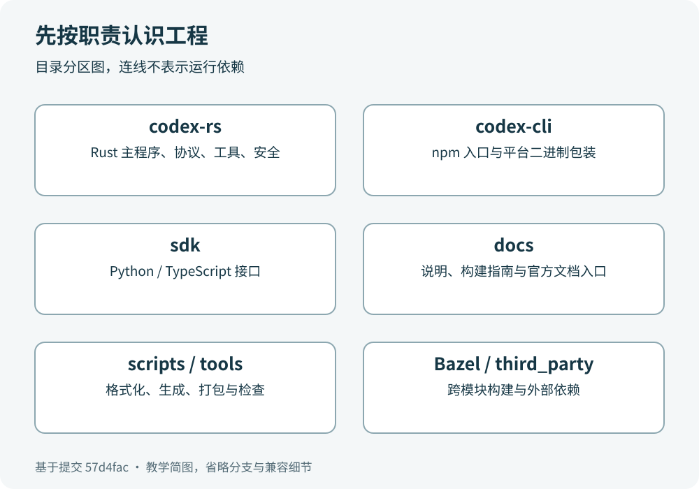

# 第 3 章　把大仓库缩成一张地图

本章回答一个实际问题：面对很多目录，怎样判断某个功能可能在哪里？我们先按职责分区，再学会用清单和依赖确认猜测。

## 先看六个区域



| 区域 | 你会在这里找什么 |
|---|---|
| `codex-rs/` | Rust 主程序、界面、会话逻辑、协议、工具与沙箱 |
| `codex-cli/` | npm 分发入口以及选择平台二进制的 JavaScript 包装 |
| `sdk/` | Python、TypeScript SDK 与 Python 运行时分发支持 |
| `docs/` | 安装、配置、认证、贡献等文档入口 |
| `scripts/`、`tools/` | 格式化、生成、打包、检查等开发辅助 |
| 根构建文件、`bazel/`、`third_party/` | 跨模块构建、外部依赖与平台工具 |

你可能注意到 `codex-cli` 名称很像“全部 CLI 源码”，实际上当前 npm 入口的工作主要是寻找适合操作系统与 CPU 架构的可执行文件，再把参数和信号交给它。Rust 的命令行入口则在 `codex-rs/cli`。

这是读工程的第一条经验：目录名提供线索，清单和源码提供证据。

## Rust 主工程中的分工

把 `codex-rs` 中的模块分成几组，会更容易记忆。CLI、TUI、exec 是不同交互入口；app-server 和它的协议、客户端、传输层负责提供统一服务接口；core 组织会话和代理循环；工具与执行服务把动作落到文件系统、进程和执行环境；codex-api、codex-client 等模块处理模型服务通信。

这些是职责分组，不代表每次请求都依次经过所有模块，也不代表这些分组各自只有一个 crate。比如文件搜索可以被不同入口复用；沙箱策略与执行环境互相配合；协议类型会被服务端和客户端同时使用。

当前版本的 TUI 和 exec 都会使用 app-server 相关通路。不要只根据旧印象画出“界面直接调用所有 core 功能”的图。第 5 章会从函数名称核对实际路径。

`backend-client` 这个名字也容易误导。它涉及账户、用量、云任务等服务能力；模型推理主链需要看 core 的模型客户端以及 codex-api、codex-client。一个仓库里有多个 client 很常见，应该继续问：“这个 client 消费什么输入、连接什么服务、被谁调用？”

## 一个 crate 是什么

你可以暂时把 crate 看成 Rust 的一个编译单元或模块包。它的 `Cargo.toml` 描述名称、依赖以及可执行文件等信息。一个 crate 可以提供库、可执行程序，或同时提供两者。

工作空间（workspace）把许多 crate 放在一起管理。`codex-rs/Cargo.toml` 的 `[workspace]` 列出成员，公共依赖和版本可集中定义。这样的结构支持把业务逻辑与界面分开，也方便只检查相关模块。

例如 `codex-rs/cli/Cargo.toml` 中，包名是 `codex-cli`，可执行文件名是 `codex`，入口文件是 `src/main.rs`。所以 Cargo 的包选择名称与最终命令名称可以不同。看见 `-p codex-cli` 和 `--bin codex` 时，不用怀疑它们是不是两个毫无关系的程序。

## 三步找到一个功能

以“字符串被截断后出现乱码”为例。第一步，猜测它属于文本处理或输出展示；第二步，在较小范围搜索截断相关名称；第三步，打开函数及测试，核对输入单位和边界。

```sh
# 从仓库根目录执行。
rg -n 'take_bytes_at_char_boundary' codex-rs
```

结果会带你找到 `utils/string` 的实现和使用位置。函数名强调字节预算与字符边界，说明不能把字节数简单当成汉字个数。到第 4 章，我们会用“你好”解释为什么。

再以“命令需要审批”为例。你可以先查 `execpolicy`、sandboxing 和执行服务的相关模块；但不要搜索一个词后就停在第一个命中点。命中位置可能只是测试、日志文字或兼容分支，必须确认它怎样参与当前执行路径。

## 不必马上读哪些部分

自动生成的协议类型、锁文件和第三方源码都很重要，但它们通常不是第一次阅读的起点。先明确你想理解的行为，再进入这些文件。例如研究 Python SDK 的类型生成时，生成脚本就很重要；研究一个按钮的输出时，先读界面事件处理更直接。

锁文件固定依赖解析结果，不能因为看不懂就删掉；第三方许可证说明也不能视为无关垃圾。暂时跳过阅读和随意改动，是两件不同的事。

## 小练习与参考答案

问题：npm 安装得到 `codex` 命令，是否说明代理循环主要用 JavaScript 实现？

参考答案：不能这样推断。当前 `codex-cli/bin/codex.js` 选择并启动原生二进制，主逻辑在 Rust 工程中。

问题：要找 CLI 的实际可执行入口，只看包名够吗？

参考答案：不够。继续看 Cargo 清单的 `[[bin]]` 和 `path`，就能把 `codex-cli`、`codex` 和 `src/main.rs` 连起来。

本章源码：[`codex-cli/bin/codex.js`](https://github.com/openai/codex/blob/57d4fac64adbcaed0523ca6bf8d58c4ef6875157/codex-cli/bin/codex.js#L16)、[`codex-rs/Cargo.toml`](https://github.com/openai/codex/blob/57d4fac64adbcaed0523ca6bf8d58c4ef6875157/codex-rs/Cargo.toml#L1)、[`codex-rs/cli/Cargo.toml`](https://github.com/openai/codex/blob/57d4fac64adbcaed0523ca6bf8d58c4ef6875157/codex-rs/cli/Cargo.toml#L1)、[`codex-rs/codex-api/README.md`](https://github.com/openai/codex/blob/57d4fac64adbcaed0523ca6bf8d58c4ef6875157/codex-rs/codex-api/README.md#L3)。
