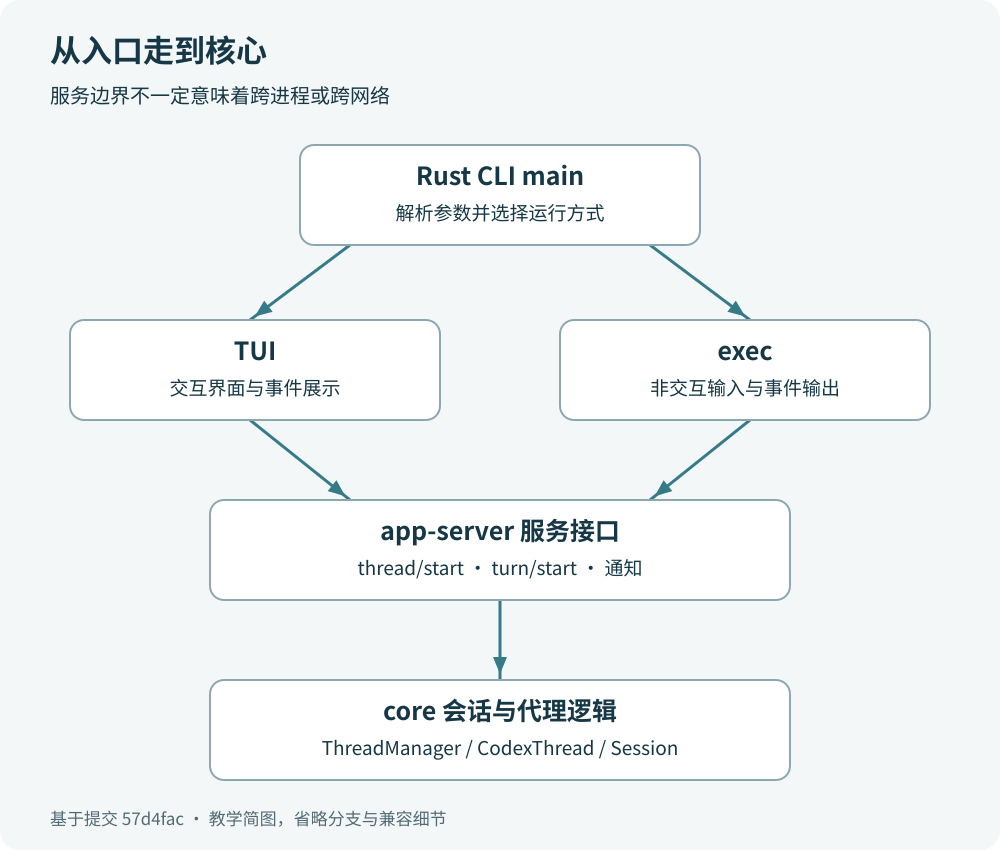

# 第 5 章　程序从哪里启动

## 先找门口，再找负责办事的人

你在终端输入 `codex`，屏幕随后出现对话界面。对新手来说，这很容易被理解成“一个文件开始运行，然后直接把问题交给模型”。实际工程分了几层：命令行入口决定去哪里，界面或脚本模式负责接收输入，应用服务组织会话，核心层执行任务。模型只是整个过程中的一个参与者。

可以把它想成一家维修店。门口接待员先问你是现场沟通，还是留下工单；前台把请求登记；维修班组查看资料、使用工具、交付结果。接待员不负责修机器，但如果接待方向错了，请求也到不了正确的工作台。

本章以当前源码中的 Rust 主程序为观察起点。若通过 npm 安装，外面还有选择并启动平台二进制的包装层；包装层解决“运行哪个可执行文件”，这里解决“可执行文件开始后发生什么”。不要把这两个入口混成同一个 `main`。



图是简化模型，省略了配置、恢复、登录和各平台启动细节。它也不表示所有箭头都跨越网络。

## main 的第一件事是分流

真正值得先打开的是 [`codex-rs/cli/src/main.rs`](https://github.com/openai/codex/blob/57d4fac64adbcaed0523ca6bf8d58c4ef6875157/codex-rs/cli/src/main.rs#L1038)。`main` 初始化构建信息，调用 `arg0_dispatch_or_else`，正常命令行路径再进入 `cli_main`。`arg0` 可以先理解为“程序被以哪个名字、怎样的辅助入口启动”；你暂时不需要掌握所有特殊分支。

`cli_main` 用 `MultitoolCli::parse()` 解析命令行。所谓解析，就是把一串文字变成程序能检查的结构。例如 `exec` 是子命令，后面的引号内容是任务输入，配置参数则进入对应字段。Rust 的 `match` 根据子命令选择分支，像按地址把信件放进不同格子。

当前源码里可以直接核对到两个关键去向：没有子命令时进入 `run_interactive_tui`，`Exec` 分支进入 `codex_exec::run_main`。其中后一处真实语句是：

```rust
codex_exec::run_main(exec_cli, arg0_paths.clone()).await?;
```

它位于 [`codex-rs/cli/src/main.rs`](https://github.com/openai/codex/blob/57d4fac64adbcaed0523ca6bf8d58c4ef6875157/codex-rs/cli/src/main.rs#L1173)。`await` 表示等待异步工作完成，`?` 表示遇到错误就向上返回。现在只需读懂“交给另一个模块，并等它完成”。

这也说明，`codex exec` 不是模拟你在完整终端界面中敲键盘。它有自己的输入和输出处理路径，适合一次执行或脚本集成。二者最终共用大量后端能力，但前台不同。

## 交互界面的实际道路

交互路径可以沿着这些具体函数查下去：

1. `cli_main` 调用 `run_interactive_tui`。
2. `run_interactive_tui` 调用 `codex_tui::run_main`。
3. TUI 的 `run_main` 进入 `startup_orchestration::run_main_inner`。
4. 启动编排完成必要准备，调用 `run_ratatui_app`。
5. `run_ratatui_app` 调用 `start_app_server`，随后启动 `App::run` 负责界面事件。

这里 TUI 是 Text User Interface，即终端里的交互界面；Ratatui 是帮助绘制这个界面的库。它们负责显示、键盘输入和状态呈现。知道术语的工作边界，比立刻研究绘图细节有用。

关键点在 `start_app_server`：当前工程的 TUI 通过应用服务接口工作。启动目标可能是内嵌服务、本地守护进程或显式选择的远程服务。此处的内嵌表示服务运行在当前进程中；守护进程则可以独立运行。选择方式受参数、配置、平台和启动条件影响，不能把“输入 codex”永远画成同一种部署。

源码证据在 [`codex-rs/tui/src/lib.rs`](https://github.com/openai/codex/blob/57d4fac64adbcaed0523ca6bf8d58c4ef6875157/codex-rs/tui/src/lib.rs#L578)：`start_app_server` 处理服务启动；内嵌分支会调用 `start_embedded_app_server` 并包装为 `AppServerClient::InProcess`。这条路径不需要先启动一个远程网站。

随后，TUI 的 `AppServerSession` 发出 `ThreadStart`、`TurnStart` 等类型明确的请求。界面与核心层之间有服务边界，因此“界面函数直接调用核心代理循环”不适合作为这个版本的完整解释。

## exec 也经过应用服务

脚本路径的起点是 [`codex-rs/exec/src/lib.rs`](https://github.com/openai/codex/blob/57d4fac64adbcaed0523ca6bf8d58c4ef6875157/codex-rs/exec/src/lib.rs#L267) 的 `run_main`。它处理配置、输入和输出等准备工作，在第 1022 行启动 `InProcessAppServerClient`。这里使用的也是应用服务，但服务是内嵌形式。

接下来，`start_thread` 发送 `ClientRequest::ThreadStart`；初始操作为用户任务时，代码发送 `ClientRequest::TurnStart`。之后进入事件接收循环，持续消费服务通知，处理输出和可能的服务请求，任务结束后执行关闭流程。

“发送请求”不等于“请求已经做完”。`turn/start` 的响应表明任务被接收、开始或转为对当前任务的追加输入；真正的过程和完成状态还要看后续通知。可以类比快递：拿到运单号说明包裹已登记，运输进度和签收是之后的事件。

这种区别对写脚本尤其重要。如果只检查“请求接口没有报错”，却不检查完成状态，就可能把执行中、失败或中断的任务当作成功。

## 从服务进入核心层

应用服务的请求分发在 `message_processor.rs`，具体线程与轮次处理分别放在 `thread_processor.rs`、`turn_processor.rs`。这里 thread 指一条持续存在的对话，不是操作系统的 CPU 线程。下一章会细讲这个容易撞名的词。

创建对话时，`thread_start_task` 调用核心层的 `ThreadManager::start_thread`。核心层继续进入内部创建流程，最终由 `Session::spawn` 建立会话状态和通信通道，并启动 `submission_loop` 接收操作。`ThreadManager` 再把可供外部使用的 `CodexThread` 句柄交回上层。

开始任务时，`turn_start_inner` 调用这个句柄的 `start_or_steer_turn`。如果会话空闲，输入会启动一轮工作；如果已有任务运行，输入也可能用于调整当前轮次。不能简单理解成“每按一次回车就一定新建一个独立任务”。

这条调用链可以缩记为：入口分流 → TUI 或 exec → 应用服务请求 → `ThreadManager` / `CodexThread` → 核心会话。斜线表示不同操作进入不同接口，并不是每次启动都依次调用两个方法。

## 读启动源码时怎样不迷路

先打开入口，找到分支，再跳到被调用的函数。遇到配置加载、登录检查或恢复逻辑，先记下它的用途，继续沿主线走。第二遍再返回研究细节，这样你始终知道当前代码服务于哪个阶段。

还要区分“函数定义”和“函数调用”。搜索 `run_main` 会找到多个模块的同名入口，判断时应同时看模块路径、参数和调用方。只凭函数名字相同就把两段流程接起来，很容易画出不存在的路线。

## 一个从启动到退出的案例

假设你已经完成安装和登录，现在就在本仓库目录中。输入下面的任务：

```sh
codex exec --sandbox read-only "请读取 README.md，用中文写出项目用途和两个入门入口，不修改文件。"
```

这是可自行尝试的运行案例，不是本书伪造的终端实测记录。网络、账号、模型和本机配置都会影响是否能运行；模型选择的读取命令、措辞和请求次数也可能不同。

先从程序角度预测过程：`cli_main` 看到 `exec`，交给 exec 模块；exec 加载配置、启动内嵌服务、创建对话，再提交用户任务；核心层准备上下文，按需要读取文件并向模型请求回答；服务把进度和结果通知 exec；exec 输出结果并关闭客户端。

从使用者角度验收则简单得多：结果应该说明项目用途，给出两个有根据的入口，并且没有修改工程文件。你可以在执行前后查看 `git status --short`；如果本来已有改动，应比较前后变化，不能要求状态必须为空。只读沙箱限制执行边界，提示中的“不修改文件”表达任务意图，二者不是同一层机制。

如果登录报错，就先查登录状态；若明确提示配置无效，应从配置入口查起；若界面卡在连接服务，则应检查服务启动和连接路径。先判断请求停在哪一层，再找文件，比盲读全部源码有效。

## 小练习与参考答案

练习一：找出源码中把 `exec` 交给独立模块的语句，并用自己的话解释 `await`。参考答案：`cli/src/main.rs:1173` 调用 `codex_exec::run_main`；`await` 在这里等待异步执行完成，不表示程序已经自动成功。

练习二：有人说“应用服务一定运行在另一台电脑”。你如何用本章源码反驳？参考答案：exec 明确启动 `InProcessAppServerClient`，TUI 也支持内嵌服务；服务是职责边界，具体运行位置另有选择。

练习三：`turn/start` 返回后能立即认定任务完成吗？参考答案：不能。还要消费执行事件，并核对终态与输出；接口接受任务和任务完成是两个时间点。

## 本章源码清单

- [`codex-rs/cli/src/main.rs`](https://github.com/openai/codex/blob/57d4fac64adbcaed0523ca6bf8d58c4ef6875157/codex-rs/cli/src/main.rs#L1038)：Rust 主入口与命令分流；交互调用见第 1147 行附近，exec 调用见第 1173 行。
- [`codex-rs/tui/src/lib.rs`](https://github.com/openai/codex/blob/57d4fac64adbcaed0523ca6bf8d58c4ef6875157/codex-rs/tui/src/lib.rs#L1145)：TUI 启动入口；`start_app_server` 位于第 578 行。
- [`codex-rs/tui/src/startup_orchestration.rs`](https://github.com/openai/codex/blob/57d4fac64adbcaed0523ca6bf8d58c4ef6875157/codex-rs/tui/src/startup_orchestration.rs#L934)：启动编排进入 `run_ratatui_app`。
- [`codex-rs/exec/src/lib.rs`](https://github.com/openai/codex/blob/57d4fac64adbcaed0523ca6bf8d58c4ef6875157/codex-rs/exec/src/lib.rs#L1022)：启动内嵌客户端；第 1411 行的 `start_thread` 发起创建对话请求。
- [`codex-rs/app-server/src/request_processors/thread_processor.rs`](https://github.com/openai/codex/blob/57d4fac64adbcaed0523ca6bf8d58c4ef6875157/codex-rs/app-server/src/request_processors/thread_processor.rs#L1550)：应用服务调用核心层创建对话。
- [`codex-rs/core/src/thread_manager.rs`](https://github.com/openai/codex/blob/57d4fac64adbcaed0523ca6bf8d58c4ef6875157/codex-rs/core/src/thread_manager.rs#L2392)：进入 `Session::spawn`；会话接收循环启动见 `core/src/session/mod.rs:1031`。
- [`codex-rs/app-server/src/request_processors/turn_processor.rs`](https://github.com/openai/codex/blob/57d4fac64adbcaed0523ca6bf8d58c4ef6875157/codex-rs/app-server/src/request_processors/turn_processor.rs#L662)：轮次开始请求进入核心层的 `start_or_steer_turn`。
