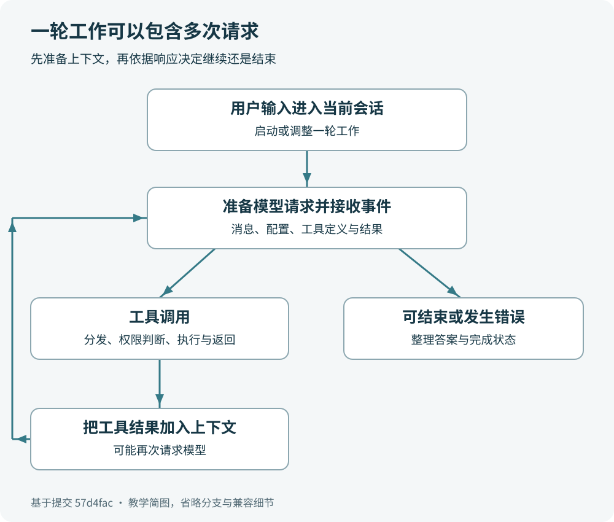

# 第 6 章　一轮对话如何变成行动

## 一句话后面可能有许多次往返

用户说“看看项目，修复这个错误，再检查一下”，界面上只出现一条用户消息。程序内部却可能发生多次模型请求：先判断要看什么，读取文件，再根据结果修改，最后运行检查并解释结果。理解这种反复，是理解 Codex 核心层的钥匙。

把模型想成一位通过工单合作的技术顾问。顾问可以提出“读取这个文件”，但它并不因为说出了这句话就拿到了文件。程序必须识别这个请求，选择工具、执行，再把结果放回工单。顾问下一次看到更新后的工单，才能继续判断。

这种类比只解释职责分工。真实程序传递的是结构化消息、工具参数和结果，不是一个人在电话另一头操作你的电脑。



图只展示常见循环，省略压缩、重试、钩子、中断和并行调度。一个 turn 可以经过图中循环多次。

## 先把四个名字分清

thread 是持续的对话单元，像一个项目的工作档案。它有身份、历史和相关配置，可以包含多轮任务。在这里，它不等于操作系统用于并行运行代码的线程。

turn 是一次被核心层接受并执行的工作轮次。常见情况是用户提交任务后开始，经过若干模型请求和工具操作后结束；运行中的追加输入也可能并入这一轮。因而“消息条数”“轮次数”“模型请求次数”是三种计数。

`Session` 是核心层管理运行状态和服务的内部对象。`CodexThread` 则是上层持有的句柄，像柜台给你的业务接口；上层不需要直接操作 Session 的所有内部字段。

`TurnContext` 承载轮次范围的信息；`StepContext` 为当前一步提供设置、环境和工具视图。当前代码明确提醒，模型请求应读取 StepContext 快照中的设置。可以把前者理解为这张工单的总资料，后者理解为“这一步开始时确认使用的资料版本”。

快照的用处是保持一致。某一步向模型公布了哪些工具、这些工具属于哪个环境、执行时依据什么设置，应当能相互对应。不能看到上下文一词，就以为它只是一段拼接后的提示文字。

## 输入先排入队列，再启动任务

上一章停在应用服务的 `turn_start_inner`。它取得对应的 `CodexThread`，构造 `TurnInputRequest`，调用 `start_or_steer_turn`。这不是直接调用模型网络接口。

继续查看 [`codex-rs/core/src/codex_thread.rs`](https://github.com/openai/codex/blob/57d4fac64adbcaed0523ca6bf8d58c4ef6875157/codex-rs/core/src/codex_thread.rs#L417)：该方法选择 `TurnInputMode::StartOrSteer`，再通过 `SessionIo` 提交输入。`SessionIo::submit_turn_input` 将请求包装成 `Op::TurnInput`，发送到会话通道，并等待接收确认。

会话的 `submission_loop` 收到这个操作后，进入 `turn_input::handle`。输入处理逻辑决定开始新任务还是调整当前任务；普通的新任务最终使用 `RegularTask`，而 `RegularTask` 调用 `run_turn`。这几层分别负责收件、判断怎样接受输入、管理任务、运行核心循环。

读源码时可以按这一条实际路线移动：`CodexThread::start_or_steer_turn` → `SessionIo::submit_turn_input` → `submission_loop` → `turn_input::handle` → `RegularTask` → `run_turn`。中间仍有辅助方法，这是一条定位用的主线，并非声称调用栈只有六层。

## run_turn 怎样准备一次请求

[`codex-rs/core/src/session/turn.rs`](https://github.com/openai/codex/blob/57d4fac64adbcaed0523ca6bf8d58c4ef6875157/codex-rs/core/src/session/turn.rs#L173) 中的 `run_turn` 是本章重点。它准备轮次所需的模型客户端会话，处理必要的上下文工作，并进入循环。循环会记录输入、取得当前步骤的上下文，再构造供模型使用的输入。

这里的输入不只包括用户最新一句话，还可能包括指令、历史消息、环境信息、之前的工具调用和结果。具体内容取决于配置、功能和当前状态；“把整个仓库每次全部上传”不是这段代码可以支持的结论。

准备好后，循环调用 `run_sampling_request`。sampling 在此表示让模型生成一次响应，可以先译作“一次模型生成请求”，不必先学概率论。

模型通信的主入口在 [`codex-rs/core/src/client.rs`](https://github.com/openai/codex/blob/57d4fac64adbcaed0523ca6bf8d58c4ef6875157/codex-rs/core/src/client.rs#L1)。文件开头就解释了生命周期：`ModelClient` 面向整个会话保存稳定状态；每轮创建的 `ModelClientSession` 用于该轮的一次或多次 Responses API 请求，并管理连接和轮次路由状态。

这个版本不能把 `backend-client` 介绍成模型推理主客户端。核心层的 ModelClient 使用 `codex-api` 提供的 Responses 客户端；HTTP 相关能力还会使用 `codex-client` 等基础设施。`backend-client` 提供账户、用量、云任务、配置等后端业务接口。名字里都有 client，不代表工作相同。

`ModelClientSession::stream` 根据提供方配置处理 Responses 通信，支持 WebSocket 路径，并在适用条件下回退到 HTTP 流。界面一边生成一边显示文字，是因为程序消费响应事件流；它不需要等整篇回答都下载完再显示。

## 响应如何变成下一步行动

响应流中既有文字增量，也可能有完整输出项、工具调用、用量和完成事件。核心代码针对事件类型分别处理。“模型生成了一段文字”和“模型发出一个工具调用”是不同的数据情况。

当收到完成的输出项，`handle_output_item_done` 调用 `ToolRouter::build_tool_call` 判断它是否能构成工具调用。如果是，程序先记录该项，再交给 `ToolCallRuntime` 安排执行，并设置需要继续生成的标志。真实代码中的关键两行是：

```rust
output.needs_follow_up = true;
output.tool_future = Some(tool_future);
```

它们位于 [`codex-rs/core/src/stream_events_utils.rs`](https://github.com/openai/codex/blob/57d4fac64adbcaed0523ca6bf8d58c4ef6875157/codex-rs/core/src/stream_events_utils.rs#L368)。`future` 可以先理解为等待完成的异步工作；这里保存的是工具工作的结果入口。

工具调用允许有调度和并行，但不能据此推断所有命令都会同时执行。运行时会依据工具能力和执行条件安排。一次响应中的工具结果收集后会记录进历史，成为后续模型输入的一部分。

外层循环综合模型是否需要继续、是否还有待处理输入等状态。代码中有这样一句：

```rust
let needs_follow_up = model_needs_follow_up || has_pending_input;
```

[`codex-rs/core/src/session/turn.rs`](https://github.com/openai/codex/blob/57d4fac64adbcaed0523ca6bf8d58c4ef6875157/codex-rs/core/src/session/turn.rs#L610) 的 `||` 表示“或者”。这直接说明，继续工作的理由不仅可能来自工具，还可能来自用户运行中补充的输入。结束判断另外还会受到预算、钩子、错误和中断等条件影响。

## 把读取 README 的案例完整走一遍

沿用上一章的只读任务：“读取 README.md，说明项目用途和两个入门入口。”下面是解释控制流程的一种可能运行过程，命令选择和请求次数并非固定输出。

第一步，用户输入被服务转换成轮次输入，核心层创建任务。历史里有了这次请求，当前步骤也确定了可用工具和运行环境。

第二步，第一次模型响应要求读取 README。模型给出工具名和参数；本地程序识别调用并执行。比如在具备 shell 工具的环境中，它可能请求运行 `sed -n '1,120p' README.md`。这是举例说明一种读取方式，不是源码强制使用的命令。

第三步，工具返回文件内容及执行状态。返回的文字不自动等于最终答案，它作为工具结果进入后续上下文。如果路径错误，结果也可能是“文件不存在”；模型应根据实际错误重新判断，不能假装已经读到内容。

第四步，后续模型请求看到 README 的真实内容，整理成中文说明。如果材料足够，可以直接给出最终回答；如果 README 指向另一个重要入口，也可能继续读取后再回答。因此不能预先承诺“这个任务恰好只请求模型两次”。

第五步，核心层结束这轮工作，应用服务将对应状态和结果交给前台。你的验收是核对描述有源码依据、两个入口确实存在，并确认执行前后的文件变化符合只读任务。

这个过程最有价值的观察是：模型提出行动，程序执行行动，结果再影响模型。只看最后一段自然语言，会漏掉真正决定可靠性的中间证据。

## 为什么会暂停、重试或中断

网络请求可能暂时失败，工具可能需要等待进程输出，审批可能等待决定，用户也可能主动中断。它们看起来都像“暂时没有新文字”，在程序里却不是同一种状态。

核心层把取消信号传给模型等待和工具运行等工作；取消意味着终止当前流程，不能把半截输出当作完整成功结果。另一方面，读取文件得到错误通常会作为工具结果供模型处理，并不必然导致整个会话消失。判断问题时应观察错误来自模型通信、具体工具还是任务控制。

上下文也有容量。工程包含自动压缩等机制，帮助较长的工作继续进行；这不等于无限保留每个细节。新手使用时仍然应该明确目标、提供关键路径，并在重要节点检查结果。

## 小练习与参考答案

练习一：一轮任务里读两个文件、改一个文件、运行一次检查，是否一定有四个 turn？参考答案：不是。这些操作可以发生在同一个 turn 中，内部可能包含多次模型请求和工具调用。

练习二：在哪个文件查模型请求的会话状态，在哪个文件查工具调用的识别？参考答案：先看 `core/src/client.rs` 的 ModelClientSession，再看 `core/src/stream_events_utils.rs` 的 `handle_output_item_done`。

练习三：工具返回“文件不存在”，可以直接判定模型通信失败吗？参考答案：不能。这是工具执行层的结果；模型服务可能正常工作，下一步需要处理路径或任务理解问题。

## 本章源码清单

- [`codex-rs/core/src/session/handlers.rs`](https://github.com/openai/codex/blob/57d4fac64adbcaed0523ca6bf8d58c4ef6875157/codex-rs/core/src/session/handlers.rs#L443)：会话提交循环；第 566 行附近处理 `Op::TurnInput`。
- [`codex-rs/core/src/session/turn_input.rs`](https://github.com/openai/codex/blob/57d4fac64adbcaed0523ca6bf8d58c4ef6875157/codex-rs/core/src/session/turn_input.rs#L622)：启动普通任务。
- [`codex-rs/core/src/tasks/regular.rs`](https://github.com/openai/codex/blob/57d4fac64adbcaed0523ca6bf8d58c4ef6875157/codex-rs/core/src/tasks/regular.rs#L105)：普通任务调用 `run_turn`。
- [`codex-rs/core/src/session/turn.rs`](https://github.com/openai/codex/blob/57d4fac64adbcaed0523ca6bf8d58c4ef6875157/codex-rs/core/src/session/turn.rs#L568)：循环请求模型；第 2721 行调用客户端流接口，第 3373 行收集尚未完成的工具。
- [`codex-rs/core/src/client.rs`](https://github.com/openai/codex/blob/57d4fac64adbcaed0523ca6bf8d58c4ef6875157/codex-rs/core/src/client.rs#L2391)：Responses 流传输选择；HTTP 分支构造 API 客户端见第 1919 行。
- [`codex-rs/core/src/stream_events_utils.rs`](https://github.com/openai/codex/blob/57d4fac64adbcaed0523ca6bf8d58c4ef6875157/codex-rs/core/src/stream_events_utils.rs#L316)：识别输出项、安排工具并标记继续。
- [`codex-rs/core/src/session/turn_context.rs`](https://github.com/openai/codex/blob/57d4fac64adbcaed0523ca6bf8d58c4ef6875157/codex-rs/core/src/session/turn_context.rs#L323)：轮次上下文与步骤快照的职责说明。
- [`codex-rs/codex-api/src/endpoint/responses.rs`](https://github.com/openai/codex/blob/57d4fac64adbcaed0523ca6bf8d58c4ef6875157/codex-rs/codex-api/src/endpoint/responses.rs#L70)：Responses HTTP 流接口。
- [`codex-rs/backend-client/src/client.rs`](https://github.com/openai/codex/blob/57d4fac64adbcaed0523ca6bf8d58c4ef6875157/codex-rs/backend-client/src/client.rs#L387)：后端业务接口，从限额、账户到云任务和配置。
