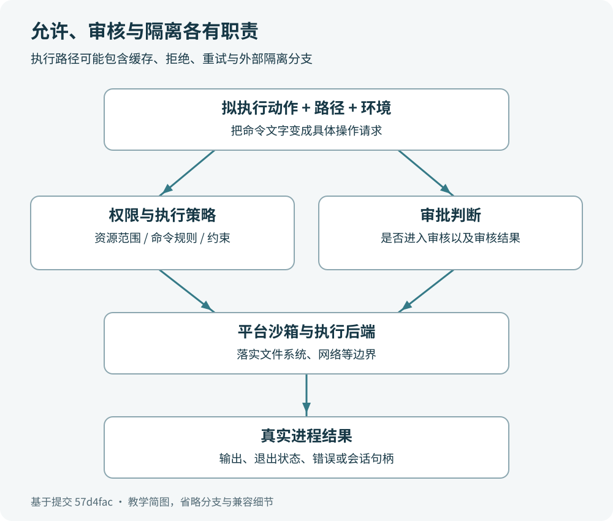

# 第 8 章　权限、策略与沙箱

## 学完这一章，你会什么

你会分清“允许访问什么”“什么时候征求同意”“操作系统怎样执行限制”，看懂常见沙箱模式，并判断一次命令失败应该查哪一层。阅读本章不需要配置沙箱，也不用向模型发送请求。

## 一个修理店里的三件事

假设你请维修师傅修电脑。你可以约定“只能检查书房里的电脑”，这是权限范围；师傅想搬动服务器时先问你，这是审批；书房门上的锁和访客账户的限制，才是实际执行边界的设施。Codex 也有对应的三层。

**权限**回答资源范围：哪些路径可以读、哪些可以写、是否能连接网络。**审批策略**回答某项操作是否需要进入审核流程，审核通过后允许什么。**平台沙箱**把规则落实到进程访问文件、建立连接等动作上。源码把审批类型和沙箱策略分别定义，正说明它们是两个不同的问题。



还有第四个容易混淆的概念：**执行策略**。它检查拟执行的命令，规则结果可以是允许、提示审批或禁止。把四个词都叫成“安全开关”，遇到错误就容易到处改设置。

## 沙箱模式像三种工作证

本提交的 `SandboxPolicy` 包含下面这些常见模式。表格只描述基础含义；最终边界还受路径规则、网络配置和运行环境影响。

| 模式 | 初学者可以怎样理解 | 适合的任务 |
| --- | --- | --- |
| `read-only` | 允许读取，限制写入 | 理解项目、阅读代码 |
| `workspace-write` | 在工作目录与额外获准目录中允许写入 | 修改代码、生成项目文件 |
| `danger-full-access` | Codex 不施加这套沙箱限制 | 由调用方明确管理执行边界的场景 |

`workspace-write` 不等于“整个用户目录都可写”。源码还专门描述了可写根目录下的受保护子路径，例如 `.git`、`.codex` 等可能影响执行行为的元数据位置。即使项目根目录可写，也不能据此推断每个子目录都可改。

网络权限也要单独看。这个版本的只读策略带有 `network_access` 字段，工作区写入策略也有同名字段，默认值都是关闭。读取本地 README 与下载依赖是两种操作；“能编辑文件”推不出“能访问互联网”。模型服务连接与被执行命令的联网边界也不应混为一谈。

还有 `external-sandbox`：运行环境向 Codex 声明外层已有隔离。它不是让 Codex 凭空创建一台虚拟机的命令，而是对已有执行环境的描述。读懂类型的用途，比看到 sandbox 一词就想象“绝对封闭的小电脑”更准确。

## “不询问”为什么不等于“全放行”

审批策略中的 `never` 表示不向用户发起命令审批。受限操作失败时，错误会返回给模型，不会借此自动获得更大的权限。因此，“只读沙箱加 never”仍可以用于限制写操作；它的实际意思是“在现有边界内工作，不能做的就失败”。

`on-request` 则允许按请求进入审批流程。审核结果、运行环境和管理员约束共同决定接下来能否执行。把它想成师傅可以申请额外工作证，比想成师傅已经拿到了所有钥匙更合适。

本提交还有 `untrusted` 和细粒度 `granular` 类型。前者用于不受信任的项目，除非明确的执行规则允许，否则命令需要审批；后者分别控制几类审批流。你暂时不用记全字段，先知道审批不是只有“永远弹窗”和“永远不弹窗”两种形态。

阅读旧教程时要留意版本差异：这里的 `on-failure` 是 `OnRequest` 的兼容反序列化别名，并不是源码里另一个独立枚举分支。先看当前安装版本的帮助，再决定教程里的参数是否适用。

## 一条命令怎样走到操作系统

可以用这条简化路线理解：工具提出命令及工作目录，运行时结合权限与执行规则判断是否需要审批，沙箱管理器把请求转成适合平台的启动方式，最后进程执行并把结果返回。真实路径包含更多状态和分支，这条路线用于定位职责。

`codex-rs/core/src/tools/sandboxing.rs` 把“无需审批”“需要审批”“禁止”表达成不同状态，并有会话审批缓存。缓存记录已批准的相关请求，可以减少重复询问；它不是把整个进程永久升级为无限权限。

`codex-rs/sandboxing/src/manager.rs` 负责选择平台后端：macOS 使用 Seatbelt，Linux 选择 Linux 沙箱类型，Windows 在启用相应能力时使用 Windows 沙箱类型。Linux 的具体实现还涉及 bubblewrap 等模块；Windows 也有不同后端。名称代表实现入口，不代表各平台的内部机制完全一样。

这也是为何“同样的命令在另一台电脑能运行”不一定说明模型理解不同。操作系统、可用后端、路径、权限配置和依赖都有可能改变结果。先读取错误中的路径和原因，再判断该查哪部分。

## 具体案例：为什么生成报告失败

你给 Codex 的任务是“阅读源码，把介绍写到 `report.md`”。读取成功，写入却报拒绝。第一步应检查当前模式：若是只读，拒绝写入符合配置；若是工作区写入，再看命令的实际工作目录，以及 `report.md` 最后解析成哪个绝对路径。

假如目标写成 `/其他目录/report.md`，它可能超出可写范围。可以把报告写回已允许的项目目录；确实需要其他目录时，再按环境支持的方式设置额外写入范围。审批是否出现取决于策略，不能用“没有弹窗”推断没有权限控制。

换成“安装依赖生成报告”后又出现网络错误，则要检查网络层。文件权限与网络权限分别诊断，排查会直接许多。还有一类普通失败：磁盘满了、工具没安装、文件名拼错了。不是每个非零退出码都来自沙箱。

你可以先执行下面的离线阅读练习。它只显示源码片段，不启动模型，不改变权限设置；在仓库根目录中运行，需要安装 `rg`：

```bash
rg -n 'pub enum AskForApproval|pub enum SandboxPolicy' codex-rs/protocol/src/protocol.rs
rg -n 'get_platform_sandbox|MacosSeatbelt|LinuxSeccomp' codex-rs/sandboxing/src/manager.rs
```

如果电脑没有 `rg`，直接在编辑器里打开对应文件搜索同样的文字即可。学习目标是找出规则与实现的位置，不是为了完成练习先编译整个工程。

## 读懂一条执行规则

下面是一条教学用的规则，它要求命令前缀为 `git push` 的请求进入审批判断。先把它当作规则文本阅读即可：

```starlark
prefix_rule(
    pattern = ["git", "push"],
    decision = "prompt",
    justification = "推送会更新远程仓库，请先审核。",
)
```

这里的列表按命令词元顺序匹配；`git status` 的前缀不同，不会因为这条规则而匹配。多个匹配规则存在时，本版本采用较严格的结果，禁止比提示更严格，提示比允许更严格。

规则解决的是“这次命令怎样判断”，不是让所有外部工具都获得相同权限。MCP 服务、调用方自行启动的程序和模型生成的文字，还要分别看它们的执行边界。看到一条规则允许某个命令，只能解释相关执行策略的判断，不能据此宣称整个系统没有其他约束。正式使用规则前应先用仓库 README 说明的检查命令验证匹配情况。

## 练习与参考答案

1. 只读模式下设置 `never`，能否据此认为 Codex 可以修改任意文件？
2. 项目文件能写，但下载包失败，应该首先区分哪两类权限？
3. 项目根目录可写，是否能断定 `.git/hooks` 也可随意改写？

参考答案：第一题不能，`never` 描述审批行为，不能消除文件限制。第二题应区分文件系统写入与网络访问，还要排查地址和依赖服务本身。第三题不能，可写根目录仍可能包含受保护的元数据子路径。三题都在训练同一件事：用具体规则解释具体动作。

## 精简源码清单

- 审批枚举及 `never` 的注释：[`codex-rs/protocol/src/protocol.rs`](https://github.com/openai/codex/blob/57d4fac64adbcaed0523ca6bf8d58c4ef6875157/codex-rs/protocol/src/protocol.rs#L1097)。
- 沙箱模式、网络字段与工作区写入：[`codex-rs/protocol/src/protocol.rs`](https://github.com/openai/codex/blob/57d4fac64adbcaed0523ca6bf8d58c4ef6875157/codex-rs/protocol/src/protocol.rs#L1183)。
- 审批结果的运行时表达：[`codex-rs/core/src/tools/sandboxing.rs`](https://github.com/openai/codex/blob/57d4fac64adbcaed0523ca6bf8d58c4ef6875157/codex-rs/core/src/tools/sandboxing.rs#L152)。
- 平台后端选择：[`codex-rs/sandboxing/src/manager.rs`](https://github.com/openai/codex/blob/57d4fac64adbcaed0523ca6bf8d58c4ef6875157/codex-rs/sandboxing/src/manager.rs#L50)。
- 命令规则的匹配与决策：[`codex-rs/execpolicy/README.md`](https://github.com/openai/codex/blob/57d4fac64adbcaed0523ca6bf8d58c4ef6875157/codex-rs/execpolicy/README.md#L5)。
